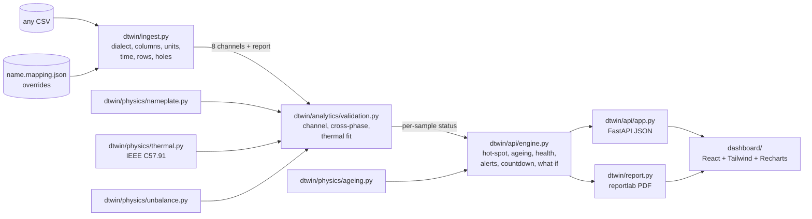

# Architecture

From a CSV the system has never seen to a dashboard that says what is wrong,
why, and what to do. Physics does the interpretation; the only fitted
quantities are a rolling regression of measured against predicted oil rise.

## Data flow

In words: the ingestion layer turns the file into eight canonical channels and
a report of every decision; the validator decides, sample by sample, which
channels to believe and whether the transformer or an instrument has changed;
the engine turns that into engineering quantities and plain-language alerts;
the API serves them as of any instant; the dashboard and the PDF present them.

## Modules

### Physics — `dtwin/physics/`

| File | Responsibility |
|---|---|
| `nameplate.py` | Every constant the twin depends on, for any rating (`preset(kva)`), with a self-check that the rated rises land the hot-spot on the ageing reference. |
| `thermal.py` | IEEE C57.91 clause 7 top-oil and hot-spot model as an exact-discretised first-order recursion, so it runs identically on a 5-minute or a 1-hour file. Steady state, time-to-threshold, and inverse (load for a target hot-spot). |
| `ageing.py` | Ageing acceleration factor F_AA, equivalent ageing hours, life consumed, its value in rupees. |
| `unbalance.py` | NEMA unbalance and the IEC voltage unbalance factor from magnitudes only (the device records no phase angles); the two load ratios the thermal model needs (RMS phase current for the oil, worst phase for the hot-spot). |

`validate_physics.py` holds 38 checks against closed-form expectations and is
the regression net for this directory.

### Simulator — `dtwin/simulate/`

`generator.py` produces the CPRI schema (IR/IY/IB, VR/VY/VB, oil, ambient) with
realistic Indian feeder load and weather; `faults.py` injects asset faults
(cooling, oil loss, overload, unbalance) and sensor faults (drift, bias,
stuck, dead) with per-sample ground truth. Used to build and score the
analytics; the real file replaces it.

### Ingestion — `dtwin/ingest.py`

Nine stages, each reported: decoding; separator and decimal-comma sniffing;
header detection with preamble skipping (and a kVA rating and tag read from
it); column identification by name tokens, then fuzzy matching, then content
for generic headers; unit inference; timestamp parsing (text day- or
month-first, epoch, Excel serial, split date and time); row hygiene (blank,
unparseable, duplicate, out of order); cadence regularisation; short-hole
interpolation. Channels the file lacks are returned as **absent**, never
invented silently. Output: a DataFrame and a `Report` (`python -m dtwin.ingest
FILE` prints it). Overrides come from the command line or a sidecar
`<name>.mapping.json`.

### Validation — `dtwin/analytics/validation.py`

Three tiers, cheapest first, each naming the suspect channel:

1. **Per channel** — dead, stuck (run length derived from the channel's own
   repeat rate), and steps a temperature cannot physically make.
2. **Cross-phase** — each phase against the other two relative to the standing
   pattern. A lone current moving with silent voltages is the CT; a change
   spread across phases or corroborated by the voltages is real unbalance.
   Failed currents are rebuilt from the healthy phases before the thermal
   model sees them.
3. **Thermal** — a rolling 24 h Huber fit of measured on predicted oil rise
   with a drift term. Slope above 1 is the transformer; intercept is the
   instrument.

Everything looks backward, so a row's status uses only data up to it.

### Engine and API — `dtwin/api/`

`engine.py` runs the validator once per dataset and nameplate (cached), then
answers queries as of a cursor: hot-spot from measured oil plus the modelled
winding gradient, ageing, the five-component health index, grouped alerts
with a headline, recommendations, the time-to-trip projection and what-if,
insulation life, the protection-setting table, the GPRS payload, and the
fault-injection self-test. `app.py` exposes it:

| Endpoint | Returns |
|---|---|
| `GET /api/scenarios` | CSVs in `data/` |
| `GET /api/{name}/state?t=&kva=` | everything the dashboard shows at cursor `t` |
| `GET /api/{name}/series?t=&hours=` | trend window ending at `t` |
| `GET /api/{name}/timeline` | coarse whole-record strip for the scrubber |
| `GET /api/{name}/whatif?t=&load=&ambient=&cf=` | projection under a held load, ambient, cooling factor |
| `GET /api/{name}/ingest` | the full mapping report |
| `GET /api/{name}/report.pdf?t=` | the PDF condition report as of `t` |
| `GET /api/selftest?kva=` | measured minimum detectable cooling degradation |

### Report — `dtwin/report.py`

Builds the PDF from the same engine state, so a report downloaded mid-replay
matches the screen. Charts are drawn with reportlab's own graphics.

### Dashboard — `dashboard/`

Vite + React + Tailwind + Recharts. One replay cursor drives every zone: a
problem-first headline with the countdown beneath it, live readings, trends,
cooling condition, recommendations, folded health and life panels, a grouped
alert feed, the existing-device comparison, what-if sliders, GPRS preview and
self-test. One colour rule for every score: green above 80, amber 40-80, red
below 40.

## Truth and scoring

`*_truth.csv` files are read by `evaluate.py` and nothing else. The validator,
engine, API and dashboard never see them. Scoring scripts:

| Script | Checks |
|---|---|
| `validate_physics.py` | 38 physics checks |
| `evaluate.py [--set heldout]` | detection, severity at detection, diagnosis, false alarms |
| `check_time_term.py` | the drift term does not absorb real cooling faults |
| `check_ingest.py` | 22 mangled variants of `showcase.csv` load and still diagnose |
